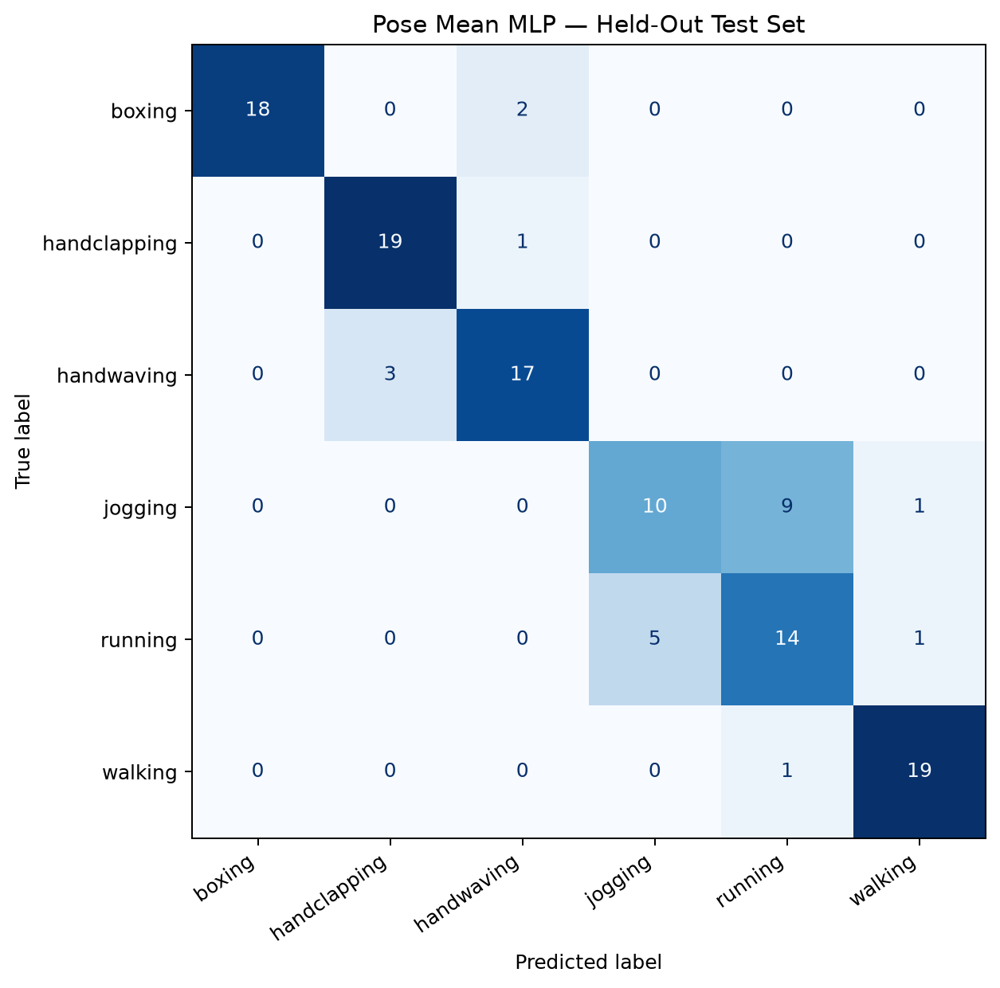

# Human Action Recognition

[](https://www.python.org/)
[](https://pytorch.org/)
[](https://ai.google.dev/edge/mediapipe/solutions/vision/pose_landmarker)
[](https://opencv.org/)
[](https://www.docker.com/)
[](https://github.com/ardaatikk/human-action-recognition/actions/workflows/ci.yml)
[](https://github.com/ardaatikk/human-action-recognition/blob/main/docs/experiments.md)
[](https://github.com/ardaatikk/human-action-recognition/blob/main/LICENSE)

### A Comparative Study of Video-Based and Pose-Based Human Action Recognition

A reproducible deep learning project investigating human action recognition through raw video frames, human pose landmarks, temporal modeling, and controlled ablation experiments.

The project evaluates multiple neural network architectures on the **KTH Human Actions Dataset**, with particular attention to:

- The effectiveness of pose-based representations compared with raw video features.
- The influence of pose detection reliability on classification performance.
- The importance of temporal ordering in sequence models.
- Model stability across different random seeds.
- The trade-off between architectural complexity and generalization.

Rather than optimizing only for the highest validation accuracy, this project emphasizes **experimental rigor, model interpretability, and reproducibility**.

**Final selected model:** Pose Mean MLP  
**Held-out test accuracy:** 80.83%  
**Held-out test macro F1:** 0.8061

---

## Table of Contents

- [Project Overview](#project-overview)
- [Research Questions](#research-questions)
- [Key Findings](#key-findings)
- [Dataset](#dataset)
- [Project Architecture](#project-architecture)
- [Data Processing Pipeline](#data-processing-pipeline)
- [Model Architectures](#model-architectures)
- [Experimental Methodology](#experimental-methodology)
- [Validation Results](#validation-results)
- [Ablation Studies](#ablation-studies)
- [Pose Detection Analysis](#pose-detection-analysis)
- [Temporal Order Sensitivity](#temporal-order-sensitivity)
- [Multi-Seed Stability Analysis](#multi-seed-stability-analysis)
- [Final Model Selection](#final-model-selection)
- [Held-Out Test Evaluation](#held-out-test-evaluation)
- [Error Analysis](#error-analysis)
- [Installation](#installation)
- [Reproducing the Pipeline](#reproducing-the-pipeline)
- [Docker](#docker)
- [Testing and Continuous Integration](#testing-and-continuous-integration)
- [Reproducibility Notes](#reproducibility-notes)
- [Limitations](#limitations)
- [Future Research](#future-research)
- [Technology Stack](#technology-stack)
- [References](#references)
- [Author](#author)

---

## Project Overview

Human action recognition aims to identify human activities from video sequences.

Traditional video-based approaches learn visual representations directly from image frames. Pose-based approaches instead use estimated human body landmarks, potentially reducing the dimensionality of the input while retaining information about body configuration and movement.

However, pose-based recognition introduces additional questions:

1. How reliably can body landmarks be extracted across different activities?
2. Can pose detection failures introduce unintended classification signals?
3. Do recurrent models actually depend on the temporal order of observations?
4. Are more complex sequence models consistently better than simpler alternatives?

This project investigates these questions using a series of controlled experiments.

The workflow begins with a CNN-LSTM baseline trained on video frames and progresses through pose-based recurrent models, feature ablations, temporal perturbation experiments, and multi-seed comparisons.

A final model is selected using validation results and evaluated on an independent test set.

---

## Research Questions

### RQ1 — Visual vs. Pose Representations

How does a CNN-LSTM trained on raw video frames compare with models trained on extracted human pose landmarks?

### RQ2 — Pose Detection Reliability

How does MediaPipe pose detection performance vary across action classes, and what relationship does detection reliability have with classification accuracy?

### RQ3 — Shortcut Learning

Can a model predict action classes using pose detection availability alone, without accessing actual landmark coordinates?

### RQ4 — Temporal Dependency

How sensitive is a coordinate-based LSTM to reversing or randomly shuffling the order of input frames?

### RQ5 — Model Stability

Does a recurrent architecture consistently outperform a simpler mean-pooled MLP across multiple random seeds?

---

## Key Findings

The main experimental findings are:

| Finding | Evidence |
|---|---|
| Pose representations outperform the initial video baseline | Full Pose LSTM: 87.50% validation accuracy; CNN-LSTM: 50.00% |
| Pose detection reliability differs substantially across actions | Validation detection rates range from 30.00% for running to 100.00% for handwaving |
| Detection availability contains class-related information | Detection-mask-only LSTM achieves 43.33% validation accuracy |
| Temporal order perturbations have limited impact on the coordinate-based LSTM | Original: 85.83%; reversed: 84.17%; shuffled: 83.33–89.17% |
| The simpler MLP is more stable across the evaluated seeds | Accuracy standard deviation: 0.48 percentage points for MLP vs. 9.94 for coordinate LSTM |
| The selected MLP generalizes reasonably to held-out subjects | 80.83% test accuracy and 0.8061 macro F1 |

These findings describe the behavior of the evaluated models on the KTH dataset. They should not be interpreted as universal conclusions about human action recognition architectures.

For complete experiment configurations, training histories, and extended analysis, see [Experimental Report](docs/experiments.md).

---

## Dataset

### KTH Human Actions Dataset

The project uses the **KTH Human Actions Dataset**, a benchmark containing videos of six human activities:

1. Boxing
2. Handclapping
3. Handwaving
4. Jogging
5. Running
6. Walking

The dataset contains recordings of different individuals performing these actions under varying recording conditions.

### Dataset Preparation

The preparation pipeline includes:

- Dataset acquisition.
- Video integrity checks.
- Exclusion of corrupted samples.
- Subject identification.
- Subject-independent train/validation/test splitting.
- Verification of split integrity.

One corrupted video is excluded, leaving **598 usable videos**.

### Dataset Split

| Split | Videos | Subjects |
|---|---:|---:|
| Training | 358 | 15 |
| Validation | 120 | 5 |
| Test | 120 | 5 |
| **Total** | **598** | **25** |

The splitting strategy is **subject-independent**.

This means individuals appearing in the training set do not appear in the validation or test sets.

Subject-independent splitting is important because randomly splitting individual videos could allow the model to recognize person-specific characteristics instead of learning representations that generalize to unseen individuals.

### Split Integrity

The dataset validation pipeline checks that:

- No subject appears in multiple splits.
- No video is duplicated across splits.
- The expected class labels are present.
- Corrupted or invalid samples are handled explicitly.

The test set is reserved for final evaluation and is not used to select the model architecture.

---

## Project Architecture

The repository separates data processing, feature extraction, model definitions, training, evaluation, and research analysis.

```text
human-action-recognition/
├── .github/
│   └── workflows/
│
├── data/
│   ├── raw/
│   └── splits/
│
├── artifacts/
│   ├── models/
│   └── reports/
│
├── docs/
│   ├── experiments.md
│   └── images/
│       └── pose_mean_mlp_test_confusion_matrix.png
│
├── outputs/
│   └── training/
│
├── src/
│   ├── analysis/
│   │   ├── pose_detection_impact.py
│   │   ├── summarize_experiments.py
│   │   └── temporal_order_impact.py
│   │
│   ├── config/
│   │   ├── paths.py
│   │   └── settings.py
│   │
│   ├── data/
│   │   ├── cache.py
│   │   ├── dataset.py
│   │   ├── download.py
│   │   ├── download_pose_model.py
│   │   ├── pose_dataset.py
│   │   ├── preprocess.py
│   │   ├── split.py
│   │   └── validate.py
│   │
│   ├── features/
│   │   ├── analyze_pose_cache.py
│   │   ├── pose_cache.py
│   │   ├── pose_extractor.py
│   │   ├── pose_normalization.py
│   │   ├── video_pose.py
│   │   └── visualize_pose.py
│   │
│   ├── models/
│   │   ├── cnn_lstm.py
│   │   ├── pose_lstm.py
│   │   └── pose_mlp.py
│   │
│   ├── training/
│   │   ├── callbacks.py
│   │   ├── engine.py
│   │   ├── evaluate.py
│   │   ├── metrics.py
│   │   ├── plots.py
│   │   └── train.py
│   │
│   └── utils/
│       └── seed.py
│
├── tests/
├── .dockerignore
├── .gitignore
├── Dockerfile
├── requirements.txt
├── requirements-dev.txt
├── README.md
└── LICENSE
```

Generated datasets, cached features, checkpoints, and training outputs are excluded from version control.

This keeps the repository focused on reproducible source code and documentation.

---

## Data Processing Pipeline

Two input representations are investigated.

### 1. Video-Based Representation

The video-based pipeline uses:

- Video decoding with OpenCV.
- Sampling of 16 frames per video.
- Grayscale image representation.
- Spatial resizing to 112 × 112.
- Tensor conversion for PyTorch.

The resulting video representation is processed by a CNN-LSTM model.

### 2. Pose-Based Representation

The pose-based pipeline extracts human body landmarks using MediaPipe Pose.

For each video:

1. Sample 16 frames.
2. Run pose landmark detection.
3. Extract body landmark information.
4. Record whether a pose was detected in each frame.
5. Normalize the extracted features.
6. Cache the resulting representation.
7. Load cached features during model training.

### Pose Feature Representation

MediaPipe provides 33 body landmarks.

The project evaluates multiple representations derived from the pose extraction pipeline.

| Representation | Shape per video | Description |
|---|---|---|
| Full pose features | 16 × 135 | Landmark-derived features and detection-related information |
| Coordinates only | 16 × 99 | Three coordinates for each of 33 landmarks |
| Detection mask only | 16 × 1 | Binary pose detection availability |

The distinction between these representations is central to the ablation experiments.

### Feature Caching

Pose extraction can be computationally expensive when repeated for every training epoch.

The project therefore caches extracted pose representations.

This provides several benefits:

- Faster subsequent training.
- Consistent feature inputs across model experiments.
- Reduced repeated MediaPipe inference.
- Easier comparison of different neural architectures.

Cached features are generated locally and are not included in the repository.

---

## Model Architectures

Five model configurations are investigated.

### 1. CNN-LSTM

**Input:** Sampled grayscale video frames.

This architecture combines:

- A convolutional feature extractor for spatial representations.
- An LSTM for sequence modeling.
- A classification head for the six action classes.

The CNN-LSTM serves as the initial video-based baseline.

**Validation accuracy:** 50.00%

### 2. Full Pose LSTM

**Input:** Full pose feature representation.

This model replaces high-dimensional image inputs with structured human pose information.

The recurrent network processes the sequence of pose features and predicts the action class.

**Validation accuracy:** 87.50%

This is the highest single-run validation accuracy among the evaluated configurations.

### 3. Coordinates-Only LSTM

**Input:** Landmark coordinates without the explicit detection-mask feature.

The purpose of this model is to investigate whether useful action recognition performance remains after removing explicit detection availability from the input representation.

**Seed 42 validation accuracy:** 85.83%

### 4. Detection-Mask-Only LSTM

**Input:** Binary pose detection availability across frames.

This ablation deliberately removes landmark coordinates.

Its purpose is to investigate whether pose detection behavior itself contains predictive information about the action class.

**Validation accuracy:** 43.33%

### 5. Pose Mean MLP

**Input:** Coordinate-based pose representation aggregated through temporal mean pooling.

Instead of using a recurrent network, this architecture summarizes the sequence and performs classification using a multilayer perceptron.

This approach tests whether an explicitly order-sensitive sequence model is necessary for the dataset.

**Seed 42 validation accuracy:** 83.33%

The Pose Mean MLP contains approximately **30,086 trainable parameters**.

---

## Experimental Methodology

### Evaluation Protocol

All primary model comparisons use the same subject-independent dataset split.

The experiments use:

- Six-class classification.
- Validation accuracy.
- Macro precision.
- Macro recall.
- Macro F1.
- Per-class classification reports.
- Confusion matrices.
- Validation-loss-based checkpoint selection.

Macro-averaged metrics give equal importance to each action class.

### Shared Training Configuration

| Parameter | Value |
|---|---|
| Batch size | 8 |
| Learning rate | 0.001 |
| Weight decay | 0.0001 |
| Early stopping patience | 7 |
| Minimum improvement | 0.0 |
| Training accelerator | Apple Metal Performance Shaders |
| DataLoader workers | 0 |

Maximum epoch settings and random seeds vary across experiments.

The exact recorded configurations and observed training histories are documented in [docs/experiments.md](docs/experiments.md).

### Checkpoint Selection

The best checkpoint is selected using the lowest validation loss.

This is important because the epoch with the highest validation accuracy is not necessarily the epoch with the lowest validation loss.

All reported primary validation metrics correspond to the selected best checkpoint.

---

## Validation Results

### Single-Seed Baseline Comparison

The following results use random seed 42.

| Model | Accuracy | Macro Precision | Macro Recall | Macro F1 |
|---|---:|---:|---:|---:|
| CNN-LSTM | 50.00% | 0.5132 | 0.5000 | 0.5012 |
| Full Pose LSTM | **87.50%** | **0.8778** | **0.8750** | **0.8709** |
| Coordinates-Only LSTM | 85.83% | 0.8695 | 0.8583 | 0.8601 |
| Detection-Mask-Only LSTM | 43.33% | 0.3375 | 0.4333 | 0.3366 |
| Pose Mean MLP | 83.33% | 0.8375 | 0.8333 | 0.8242 |

The pose-based approaches substantially outperform the initial CNN-LSTM baseline in these experiments.

However, the full pose representation also includes detection-related information, motivating further analysis.

---

## Ablation Studies

### Why Ablation Studies?

Ablation studies isolate specific input components or modeling assumptions.

Instead of asking only which architecture performs best, they investigate what information the models may be using.

### Coordinates-Only Ablation

Removing the explicit detection-mask feature produces a validation accuracy of **85.83%**.

This is close to the **87.50%** obtained by the full pose model.

The result suggests that coordinate-based information remains highly predictive.

However, removing an explicit detection mask does not necessarily eliminate all information associated with detection failures, because missing or unreliable landmarks may still influence the coordinate representation.

### Detection-Mask-Only Ablation

The detection-mask-only model achieves:

- Accuracy: **43.33%**
- Macro precision: **0.3375**
- Macro recall: **0.4333**
- Macro F1: **0.3366**

For six balanced classes, uniform random guessing has an expected accuracy of approximately **16.67%**.

The detection-mask-only result therefore indicates that pose detection availability contains class-related information.

This creates a potential shortcut-learning concern.

The model may exploit dataset-specific pose detection patterns rather than learning meaningful movement geometry.

This result does **not** establish that data leakage occurred.

It demonstrates that the detection process itself should be treated as a possible source of unintended predictive information.

---

## Pose Detection Analysis

### Detection Reliability by Action

The average MediaPipe pose detection rates on the validation set are:

| Action | Mean Detection Rate |
|---|---:|
| Boxing | 95.94% |
| Handclapping | 99.38% |
| Handwaving | 100.00% |
| Jogging | 36.25% |
| Running | 30.00% |
| Walking | 41.25% |

The difference between upper-body actions and locomotion activities is substantial.

In this dataset, pose detection is much more reliable for boxing, handclapping, and handwaving than for jogging, running, and walking.

### Classification Accuracy by Detection Group

For the Full Pose LSTM validation predictions:

| Detection Group | Videos | Accuracy |
|---|---:|---:|
| Low | 25 | 64.00% |
| Medium | 34 | 88.24% |
| High | 61 | 96.72% |

Higher detection groups exhibit higher observed classification accuracy.

However, this relationship is potentially confounded by action class.

For example, upper-body actions are concentrated in the high-detection group, while locomotion activities dominate the lower-detection groups.

Consequently, these results should be interpreted as an **observational association**, not proof that increasing detection reliability would independently improve accuracy.

---

## Temporal Order Sensitivity

To investigate temporal dependence, the trained Coordinates-Only LSTM is evaluated under three conditions:

1. **Original:** Frames retain their original order.
2. **Reversed:** The temporal sequence is reversed.
3. **Shuffled:** Frames are randomly reordered.

Shuffling is repeated 10 times using different random seeds.

### Results

| Condition | Accuracy | Agreement with Original Predictions |
|---|---:|---:|
| Original | 85.83% | 100.00% |
| Reversed | 84.17% | 88.33% |
| Shuffled, 10 runs | 83.33–89.17% | 87.50–94.17% |

The model maintains similar accuracy even after substantial temporal perturbations.

This suggests that its predictions rely considerably on information that is not strongly dependent on the original frame order.

Nevertheless, the prediction agreement is below 100%, so temporal ordering does affect some predictions.

These results do not demonstrate that the LSTM ignores temporal information entirely.

Instead, they motivate evaluating a simpler model that does not explicitly preserve frame order.

---

## Multi-Seed Stability Analysis

Single-run performance can be sensitive to random initialization and training dynamics.

To investigate this, the Coordinates-Only LSTM and Pose Mean MLP are trained with three random seeds:

**42, 123, and 456**

The dataset split remains fixed.

### Validation Accuracy

| Seed | Coordinates-Only LSTM | Pose Mean MLP |
|---|---:|---:|
| 42 | 85.83% | 83.33% |
| 123 | 67.50% | 82.50% |
| 456 | 83.33% | 82.50% |
| **Mean** | **78.89%** | **82.78%** |
| **Sample Std. Dev.** | **9.94 pp** | **0.48 pp** |

### Macro F1

| Seed | Coordinates-Only LSTM | Pose Mean MLP |
|---|---:|---:|
| 42 | 0.8601 | 0.8242 |
| 123 | 0.6619 | 0.8177 |
| 456 | 0.8316 | 0.8174 |
| **Mean** | **0.7846** | **0.8198** |

The LSTM achieves a higher score in the seed-42 run but exhibits substantially greater variability across the three evaluated seeds.

The MLP produces more consistent results and a higher three-seed mean.

Because only three seeds were evaluated, these observations are descriptive and do not establish statistical significance.

---

## Final Model Selection

The final model is selected using validation evidence rather than test performance.

Although the Full Pose LSTM achieves the highest individual validation accuracy, it also uses detection-related information that may reflect dataset-specific pose extraction behavior.

The Coordinates-Only LSTM reduces reliance on an explicit detection mask but exhibits considerable variation across random seeds.

The Pose Mean MLP is selected because it offers:

- Competitive validation accuracy.
- Higher mean validation accuracy than the coordinate LSTM across the evaluated seeds.
- Much lower observed seed-to-seed variability.
- A simpler architecture.
- Lower computational complexity.
- A useful baseline for investigating order-insensitive pose representations.

The final held-out evaluation uses the **seed-42 Pose Mean MLP best checkpoint**.

The test set is not used to select the architecture or checkpoint.

---

## Held-Out Test Evaluation

The selected Pose Mean MLP is evaluated on the independent test split containing **120 videos from five unseen subjects**.

### Final Results

| Metric | Score |
|---|---:|
| Accuracy | **80.83%** |
| Macro Precision | 0.8114 |
| Macro Recall | 0.8083 |
| Macro F1 | **0.8061** |
| Test Videos | 120 |
| Correct Predictions | 97 |
| Incorrect Predictions | 23 |

### Confusion Matrix



### Per-Class Performance

| Action | Precision | Recall | F1 |
|---|---:|---:|---:|
| Boxing | 1.000 | 0.900 | 0.947 |
| Handclapping | 0.864 | 0.950 | 0.905 |
| Handwaving | 0.850 | 0.850 | 0.850 |
| Jogging | 0.667 | 0.500 | 0.571 |
| Running | 0.583 | 0.700 | 0.636 |
| Walking | 0.905 | 0.950 | 0.927 |

The model performs particularly well on boxing, handclapping, and walking.

Jogging and running remain the most challenging classes.

---

## Error Analysis

### Jogging vs. Running

The test confusion matrix reveals substantial confusion between jogging and running:

- **9 jogging videos** are predicted as running.
- **5 running videos** are predicted as jogging.

This is the dominant error pattern in the final model.

A plausible explanation is that temporally averaged pose coordinates preserve body configuration but discard information about movement order and dynamics.

However, the experiment does not isolate mean pooling as the cause of these errors.

Other factors may contribute, including:

- Similar body configurations across locomotion classes.
- Differences in pose detection reliability.
- Subject-specific movement characteristics.
- Limited training data.
- Recording conditions.

### Validation-to-Test Generalization

The selected checkpoint achieves:

- Validation accuracy: **83.33%**
- Test accuracy: **80.83%**

The difference is **2.50 percentage points**.

This provides an estimate of performance on held-out subjects under the dataset's evaluation protocol.

It does not establish performance on unrestricted real-world videos.

---

## Installation

### Requirements

- Python 3.11
- PyTorch
- OpenCV
- MediaPipe
- NumPy
- Pandas
- scikit-learn
- Matplotlib
- tqdm

### Clone the Repository

```bash
git clone https://github.com/ardaatikk/human-action-recognition.git
cd human-action-recognition
```

### Install Dependencies

```bash
python -m pip install -r requirements.txt
```

For development and testing:

```bash
python -m pip install -r requirements-dev.txt
```

### Hardware Support

The training pipeline supports:

- CPU
- Apple MPS
- CUDA, when available

The project was developed and evaluated primarily on Apple Silicon using PyTorch MPS.

---

## Reproducing the Pipeline

### Step 1 — Download the Dataset

```bash
python -m src.data.download
```

The download script prepares the dataset in the expected local directory structure.

### Step 2 — Create Dataset Splits

```bash
python -m src.data.split
```

The splitting procedure generates subject-independent train, validation, and test CSV files.

### Step 3 — Download the MediaPipe Pose Model

```bash
python -m src.data.download_pose_model --variant full
```

**Important:** The MediaPipe model variant used for feature extraction must match the variant used to produce the cached features for the original experiments. Changing the variant may change the resulting features and model performance.

### Step 4 — Extract and Cache Pose Features

```bash
python -m src.features.pose_cache \
  --splits train validation test \
  --num-frames 16
```

This step extracts and stores pose information for subsequent training and evaluation.

### Step 5 — Train a Model

Example: Pose Mean MLP.

```bash
python -m src.training.train \
  --model pose_mean_mlp \
  --experiment pose_mean_mlp_reproduction \
  --epochs 50 \
  --batch-size 8 \
  --lr 0.001 \
  --patience 7 \
  --weight-decay 0.0001 \
  --seed 42 \
  --device auto
```

This creates a new experiment rather than overwriting the original baseline.

### Step 6 — Evaluate on Validation

```bash
python -m src.training.evaluate \
  --model pose_mean_mlp \
  --experiment pose_mean_mlp_reproduction \
  --split validation \
  --checkpoint best \
  --device auto
```

### Step 7 — Evaluate the Selected Model

After selecting a model using validation results, evaluate it on the held-out test split.

For the original final experiment:

```bash
python -m src.training.evaluate \
  --model pose_mean_mlp \
  --experiment pose_mean_mlp_baseline \
  --split test \
  --checkpoint best \
  --device auto
```

This command requires the corresponding locally generated checkpoint.

### Available Training Models

The training CLI supports:

```text
cnn_lstm
pose_lstm
pose_mask_lstm
pose_coordinates_lstm
pose_mean_mlp
```

### Training Outputs

Experiments generate:

- Training configurations.
- Epoch-by-epoch histories.
- Best and last checkpoints.
- Evaluation metrics.
- Per-video predictions.
- Confusion matrices and analysis artifacts.

Generated outputs are stored locally and excluded from Git.

---

## Docker

The project includes a Docker environment for reproducible CPU execution and automated testing.

### Build the Image

```bash
docker buildx build \
  --platform linux/amd64 \
  --load \
  -t human-action-recognition:latest .
```

The explicit `linux/amd64` platform is useful on Apple Silicon systems because of dependency wheel compatibility.

### Run Tests

```bash
docker run --rm \
  --platform linux/amd64 \
  human-action-recognition:latest
```

### Run the Training Pipeline

Mount local data and artifact directories:

```bash
docker run --rm \
  --platform linux/amd64 \
  -v "$(pwd)/data:/app/data" \
  -v "$(pwd)/artifacts:/app/artifacts" \
  -v "$(pwd)/outputs:/app/outputs" \
  human-action-recognition:latest \
  python -m src.training.train \
    --model pose_mean_mlp \
    --experiment docker_pose_mean_mlp \
    --epochs 5 \
    --device cpu
```

### Docker Limitations

The container uses CPU execution.

Apple MPS acceleration is not available inside the Linux container.

Building the image on Apple Silicon may also require architecture emulation, resulting in longer build times.

The Docker image is intended primarily for reproducible execution and validation rather than optimized GPU training.

---

## Testing and Continuous Integration

The project includes automated unit tests covering the machine learning pipeline.

At the time of the final development validation, **131 unit tests passed**.

### Run Tests Locally

```bash
python -m pytest tests/unit -q
```

### GitHub Actions

The repository includes a GitHub Actions workflow that:

1. Checks out the repository.
2. Sets up Python 3.11.
3. Installs development dependencies.
4. Executes the unit test suite.

Continuous integration helps detect regressions when the codebase changes.

---

## Reproducibility Notes

### Random Seeds

The project supports explicit random seed configuration.

Multi-seed experiments use:

```text
42
123
456
```

### Fixed Dataset Split

All primary comparisons use the same subject-independent dataset split.

This avoids introducing split variation into the architecture comparison.

### Best Checkpoint Selection

Reported results use checkpoints selected by minimum validation loss.

### Resumed Training

Some baseline experiments were developed incrementally using checkpoint resumption.

Consequently, certain saved `config.json` files contain an earlier requested epoch limit, while the corresponding `history.csv` files record additional training epochs.

The training histories are the authoritative record of how many epochs were actually completed.

This discrepancy is documented explicitly in the experimental report.

### Hardware and Numerical Variability

Exact results may vary across:

- Hardware backends.
- PyTorch versions.
- MediaPipe model variants.
- Numerical kernels.
- Random initialization.
- Dependency versions.

Random seed control improves reproducibility but does not guarantee bitwise-identical results across all environments.

### Generated Artifacts

The repository does not distribute the complete dataset, pose cache, or trained checkpoints.

Users can reproduce the pipeline using the provided scripts, but exact reproduction of the reported results requires matching the original preprocessing configuration and experiment settings.

---

## Limitations

The project has several limitations.

**Dataset size:** KTH is relatively small compared with modern action recognition benchmarks.

**Dataset diversity:** The recording conditions and action classes do not represent the full complexity of real-world activity recognition.

**Pose detection reliability:** MediaPipe detection rates differ substantially across action classes.

**Potential shortcut signals:** Detection availability contains predictive information and may introduce dataset-specific shortcuts.

**Temporal modeling:** The temporal perturbation experiments suggest limited sensitivity to frame ordering in the evaluated coordinate LSTM.

**Statistical uncertainty:** The stability comparison uses only three random seeds.

**Model selection:** The final model was selected using validation evidence, but not every architecture received the same multi-seed evaluation.

**Deployment:** The repository focuses on offline experimental evaluation rather than a production real-time inference service.

---

## Future Research

Potential extensions include:

- Evaluating additional pose estimation architectures.
- Comparing different pose normalization strategies.
- Investigating velocity and acceleration features.
- Adding temporal differences to the mean-pooled representation.
- Evaluating temporal convolutional networks.
- Comparing attention-based sequence models.
- Expanding multi-seed experiments.
- Investigating class-conditional detection effects.
- Evaluating on additional action recognition datasets.
- Studying robustness under occlusion and camera variation.
- Developing a real-time inference interface.

These are proposed directions, not completed experiments.

---

## Technology Stack

**Language:** Python

**Deep Learning:** PyTorch

**Computer Vision:** OpenCV, MediaPipe

**Data Processing:** NumPy, Pandas

**Evaluation:** scikit-learn

**Visualization:** Matplotlib

**Testing:** pytest

**Infrastructure:** Docker, GitHub Actions

**Acceleration:** Apple Metal Performance Shaders

---

## References

### Dataset

Schüldt, C., Laptev, I., & Caputo, B. (2004).

*Recognizing Human Actions: A Local SVM Approach.*

Proceedings of the 17th International Conference on Pattern Recognition (ICPR).

### Pose Estimation

[MediaPipe Pose Landmarker Documentation](https://ai.google.dev/edge/mediapipe/solutions/vision/pose_landmarker)

### Deep Learning Framework

[PyTorch Documentation](https://pytorch.org/docs/stable/index.html)

---

## License

This project is licensed under the MIT License. See the [LICENSE](LICENSE) file for details.

The KTH Human Actions Dataset and third-party model assets are subject to their respective licenses and usage terms.

---

## Author

**Arda Atik**

Artificial Intelligence Engineer

- [GitHub](https://github.com/ardaatikk)
- [Portfolio](https://ardaatik.dev)

---

## Project Status

**Research implementation completed.**

The repository includes:

- Reproducible dataset preparation.
- Multiple model architectures.
- Controlled ablation experiments.
- Temporal sensitivity analysis.
- Multi-seed stability evaluation.
- Held-out test evaluation.
- Automated testing.
- Docker support.
- Research documentation.

See [docs/experiments.md](docs/experiments.md) for the complete experimental record.